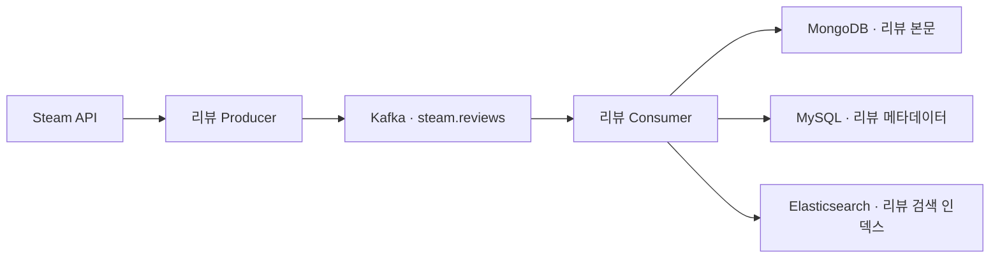

# PLAYLOG | Steam 리뷰 기반 게임 검색·추천

PLAYLOG는 Steam 리뷰에서 실제 플레이 경험을 찾아 게임을 검색하고 비교하는 웹 서비스입니다. 게임 제목뿐 아니라 리뷰 본문으로 게임을 찾을 수 있으며, 게임별 키워드와 추천·비추천 추이를 비교할 수 있습니다.

## 주요 기능

| 기능 | 설명 |
|---|---|
| 게임 탐색 | Steam API로 수집한 게임 목록을 조회하고 제목과 리뷰 키워드로 탐색 |
| 리뷰 본문 검색 | Elasticsearch로 리뷰 본문을 검색하고, 일치하는 리뷰를 게임별로 묶어 표시 |
| 게임 상세 | 리뷰를 추천 여부와 작성 당시 플레이 시간으로 필터링하고 10건씩 조회 |
| 리뷰 워드클라우드 | 리뷰 본문에서 추출한 키워드의 언급 건수를 시각화 |
| 게임 비교 | 두 게임의 키워드 언급 비율, 추천·비추천 비율, 리뷰 건수를 비교 |
| 취향 추천 | 사용자가 선택한 게임의 긍정 리뷰에서 자주 등장하는 키워드로 유사 게임 추천 |
| 회원 기능 | 회원가입, 로그인, 세션 쿠키를 이용한 새로고침 후 로그인 상태 복원 |

## 기술 스택과 데이터 역할

| 기술 | 역할 |
|---|---|
| React · Vite · Recharts | 게임 탐색, 리뷰 상세, 워드클라우드 및 비교 차트 |
| Node.js · Express | REST API, 회원 인증, 리뷰 키워드 분석 및 데이터 연결 |
| MySQL | 게임 정보, 리뷰 메타데이터, 회원 및 세션 저장. 리뷰 필터·페이지네이션과 평가 통계 집계 |
| MongoDB | 리뷰 원문과 정제 본문 보관 |
| Elasticsearch | 리뷰 본문과 키워드를 검색용 문서로 색인 |
| Kafka | Steam 리뷰를 수집하는 Producer와 저장·색인하는 Consumer 사이에서 메시지 전달 |
| Redis | 게임 목록·상세, 키워드, 비교 통계, 검색, 추천 결과를 두 웹서버가 공유할 수 있도록 캐시 |

## 리뷰 수집과 검색 흐름



Consumer는 두 DB에 리뷰를 저장하고, 본문이 있는 리뷰는 Elasticsearch에 색인한 뒤 Kafka 오프셋을 커밋합니다. 같은 리뷰 ID가 다시 수집되면 기존 저장 데이터와 검색 문서를 갱신합니다.

상세 화면에서는 MySQL이 조건에 맞는 리뷰 ID를 페이지당 최대 10개 조회하고, MongoDB가 해당 리뷰의 본문을 제공합니다. 워드클라우드 키워드는 Node.js가 리뷰 본문에 사전 표현이 포함되어 있는지 확인해 추출합니다. 한 리뷰에서 같은 키워드를 여러 번 언급해도 한 건으로 집계합니다.

## 로컬 검증 결과

| 항목 | 확인 결과 |
|---|---|
| 게임 데이터 | MySQL 게임 1,001개 |
| 리뷰 데이터 | 5개 게임의 리뷰 메타데이터 1,000건 저장 |
| 검색 인덱스 | `playlog-reviews-v1` 문서 994건 확인 |
| 검색 테스트 | `hacker`로 리뷰 본문을 검색해 관련 게임 조회 |
| Kafka 수집 | 서로 다른 리뷰 1,000건 발행 확인 |
| 세션 | 로그인 후 페이지를 새로고침해도 로그인 상태 복원 |

리뷰 통계와 추천은 프로젝트에서 수집한 리뷰 표본을 기준으로 합니다. 색인 스크립트는 검색할 본문이 비어 있는 리뷰를 건너뜁니다.

## 주요 API

| 메서드 | 경로 | 설명 |
|---|---|---|
| `GET` | `/api/health` | 웹 프로세스 응답 확인 |
| `GET` | `/api/games` | 게임 목록 조회 |
| `GET` | `/api/games/:id` | 게임 상세 조회 |
| `GET` | `/api/games/:id/reviews` | 리뷰 필터 및 페이지네이션 |
| `GET` | `/api/games/:id/keywords` | 워드클라우드 키워드 조회 |
| `GET` | `/api/game-ratings?ids=730,413150` | 선택한 게임의 평가 건수와 기간별 집계 |
| `POST` | `/api/search` | 게임 제목·키워드·리뷰 본문 검색 |
| `POST` | `/api/recommendations` | 선택한 게임을 기준으로 유사 게임 추천 |
| `POST` | `/api/auth/signup` | 회원가입 |
| `POST` | `/api/auth/login` | 로그인 및 세션 발급 |
| `GET` | `/api/auth/me` | 현재 로그인한 회원 조회 |

## 로컬 실행

프로젝트 루트에서 의존성을 설치합니다.

```bash
npm ci
```

`backend/.env.example`을 참고해 `backend/.env`를 만들고 MySQL, MongoDB, Kafka 및 Elasticsearch 접속 정보를 설정합니다. Redis를 사용할 때는 `REDIS_URL`을 설정합니다. 실제 API 키와 비밀번호는 각 실행 환경에서 관리합니다.

Elasticsearch가 자체 CA로 HTTPS를 제공하는 경우, Node.js를 실행하는 셸이나 서비스 환경에 `NODE_EXTRA_CA_CERTS`로 CA 인증서 경로를 지정합니다.

```bash
# 기존 리뷰를 Elasticsearch에 최초 색인
node --env-file=backend/.env backend/scripts/index-reviews.mjs

# 프론트엔드와 백엔드 실행
npm run dev
```

Kafka 리뷰 수집을 확인하려면 별도 터미널에서 Consumer를 시작한 뒤 Producer를 실행합니다.

```bash
# 터미널 1
node --env-file=backend/.env backend/scripts/steam-reviews.mjs consume

# 터미널 2
node --env-file=backend/.env backend/scripts/steam-reviews.mjs produce
```

## VM 배포 계획

총 11대의 VM을 사용합니다. Web1과 Web2에 같은 버전의 PLAYLOG를 배포하고, HAProxy가 두 웹서버로 요청을 분산합니다.

| 구성 | 대수 | 역할 |
|---|---:|---|
| NAT | 1 | 외부 웹 요청을 내부 HAProxy로 전달 |
| HAProxy | 1 | Web1·Web2 로드밸런싱 및 `/api/health` 확인 |
| Web1·Web2 | 2 | React 화면 및 Node.js API 실행 |
| MySQL | 2 | Primary와 Replica 구성 |
| MongoDB | 2 | 리뷰 본문을 저장하는 데이터 노드 간 복제 |
| 백업 VM | 1 | DB 백업 보관 및 복구 검증 |
| Kafka·Redis | 1 | 리뷰 메시지 전달 및 공용 캐시 |
| Elasticsearch | 1 | 리뷰 본문 색인 및 검색 |

VM 배포 시 기존 MySQL·MongoDB 데이터를 이전하고 Elasticsearch에서 최초 색인을 수행합니다. Web1에만 수집 Producer의 `systemd timer`와 상시 Consumer 서비스를 등록할 계획입니다. 배포 검증에는 HAProxy를 통한 검색, Web1·Web2의 Redis 캐시 공유, DB 복제 및 백업 복구가 포함됩니다.
