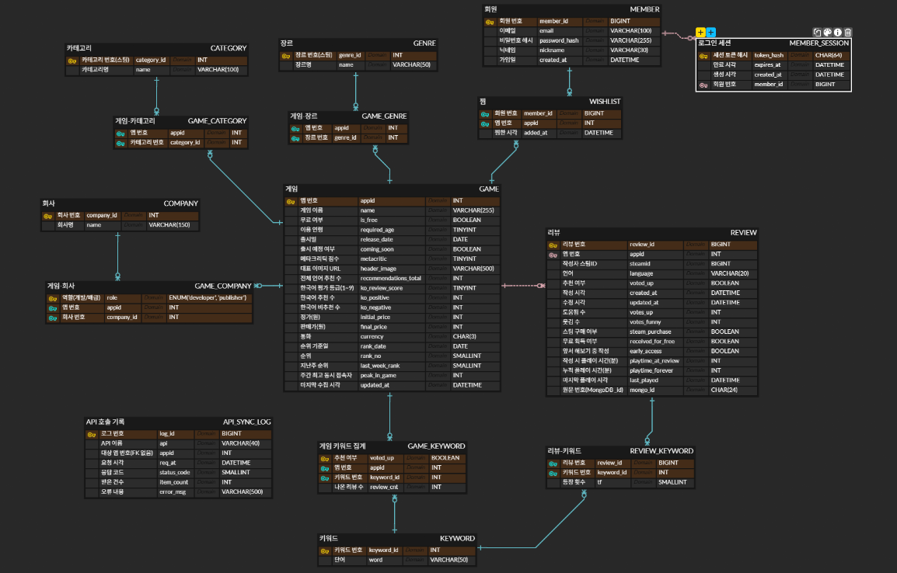
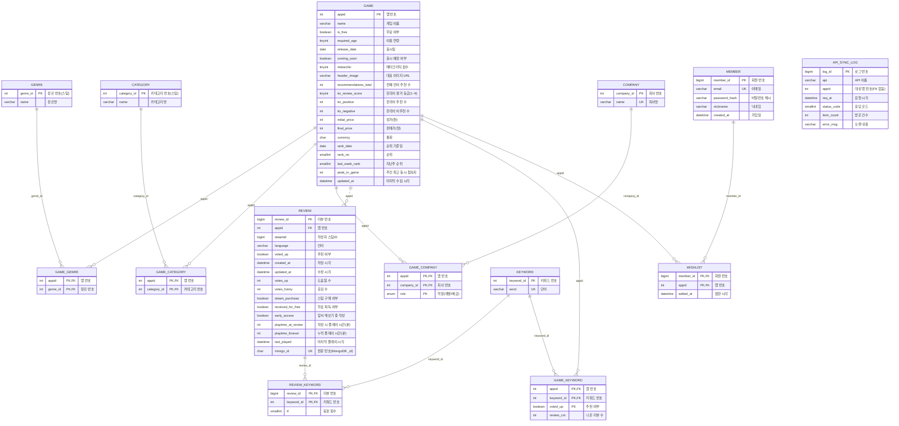
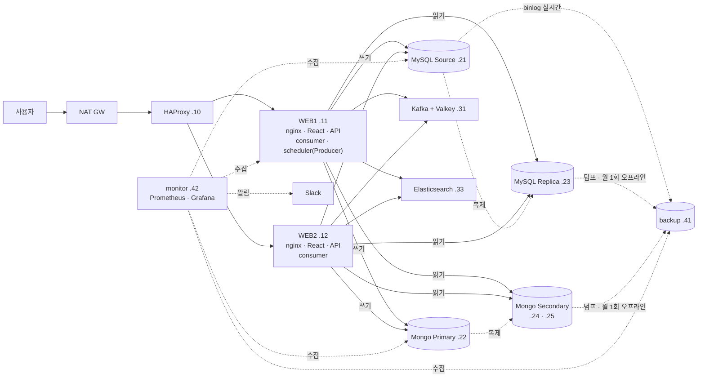

[README.md](https://github.com/user-attachments/files/34723989/README.md)
# PLAYLOG — 스팀 한국어 리뷰 키워드 분석 플랫폼

> DB 프로젝트 · 팀원 김남국 · 한예찬 · 황시영
> 스팀 한국어 리뷰를 모아, 유저들이 각 게임을 어떤 단어로 이야기하는지 보여 주는 서비스

> 📝 이 문서에서 `✏️ 작성 필요` 상자가 있는 곳은 담당 팀원이 내용을 채울 자리입니다. 채운 뒤 상자(`> [!IMPORTANT]` 블록)는 지웁니다.

## 📐 DB 설계 (ERD)



- **MySQL 테이블 14개 · 모두 3NF** — `GAME_KEYWORD`만 화면 속도를 위한 의도적 반정규화
- 왼쪽 열 = 논리 이름(한글) · 가운데 = 물리 이름 · 오른쪽 = MySQL 타입 (ERDCloud)
- 실선 = 식별 관계 (부모 키가 자식 PK의 일부) · 점선 = 비식별 관계 (`GAME` → `REVIEW`)
- 리뷰 **본문(비정형)** 은 MongoDB `review_text` 에 두고 `REVIEW.mongo_id` 로 1:1 연결

<details>
<summary>ERD 코드 (Mermaid — 깃허브가 바로 그려 줌)</summary>


</details>

| 영역 | 테이블 |
|---|---|
| 게임 · 분류 | `GAME` · `GENRE` · `GAME_GENRE` · `CATEGORY` · `GAME_CATEGORY` · `COMPANY` · `GAME_COMPANY` |
| 리뷰 · 키워드 | `REVIEW` · `KEYWORD` · `REVIEW_KEYWORD` · `GAME_KEYWORD`(반정규화) |
| 회원 · 수집 | `MEMBER` · `WISHLIST` · `API_SYNC_LOG`(FK 없는 로그) |
| 뷰 | `V_GAME_SUMMARY` — 할인율 · 긍정률 · 마지막 리뷰 시각 (계산값은 저장하지 않음) |

설계 과정: 요구사항 명세(19문장) → 엔티티 8 · 관계 7 (E-R 다이어그램) → 비정규형 → 1NF → 2NF → 3NF → 물리 설계(타입 · 도메인 · 인덱스)

---

## 🧱 기술 스택

| 구분 | 사용 기술 |
|---|---|
| 프론트엔드 | React 19 · Vite 7 · Recharts 3 |
| 백엔드 | Node.js 22 · Express 5 · node-cron |
| 정형 DB | MySQL 8.4 — Source(쓰기) → Replica(읽기) GTID 복제 |
| 비정형 DB | MongoDB 8.0 — 복제 세트 3노드 P + S + S (자동 장애 조치) |
| 검색 | Elasticsearch 9.5 + analysis-nori (한국어 형태소 분석) |
| 캐시 | Valkey (Redis 호환) |
| 메시징 | Apache Kafka 4.3 (KRaft) — 리뷰 수집 큐 · 파티션 2 |
| 인프라 | Rocky Linux 10 VM 13대 · HAProxy · nginx · pm2 |
| 모니터링 | Prometheus · Alertmanager(→ Slack) · Grafana 13 · exporter (node · mysqld · mongodb · haproxy · redis · kafka · elasticsearch) |
| 백업 | mysqldump · mongodump (매일) · binlog 실시간 전송 (증분 · PITR) · 월 1회 오프라인 백업 · GFS 보관 계층 |
| 데이터 출처 | Steam 공식 Web API (GetMostPlayedGames · appdetails · GetAppReviews) |

## 👥 역할 분담

| 담당 | 맡은 부분 | 문서 |
|---|---|---|
| 김남국,한예찬,황시영 | DB설계 |---|
| 김남국 | DB 설계 · HAProxy · WEB1/WEB2 · MySQL Source/Replica · Redis(Valkey) · Kafka · Elasticsearch | [`docs/INFRA.md`](docs/INFRA.md) · [`docs/QUERIES.md`](docs/QUERIES.md) |
| 한예찬 | NAT 게이트웨이 · 네트워크 | 아래 [NAT](#-nat-게이트웨이) |
| 한예찬 | MongoDB 복제 세트 · 클러스터 (.22 · .24 · .25) | [`docs/MONGODB.md`](docs/MONGODB.md) |
| 한예찬 · 김남국 · 황시영 | 백업 서버 (.41) · 모니터링 (.42) · 백업 전략 | [`docs/BACKUP.md`](docs/BACKUP.md) · [`docs/MONITORING.md`](docs/MONITORING.md) |

> [!IMPORTANT]
> ✏️ **작성 필요 — 담당: 팀원**
> 담당자 이름과 맡은 부분이 다르면 위 표를 고쳐 주세요.

## 🗺️ 아키텍처



| IP | 호스트 | 역할 | 담당 |
|---|---|---|---|
| — | 인프라 세팅 | VM 템플릿 · 네트워크 | 황시영 |
| 192.168.0.224 | NAT GW | 외부 접속 → 내부망 연결 · HAProxy 포워딩 | 황시영 |
| 192.168.56.10 | lb | HAProxy (roundrobin) | 김남국 |
| 192.168.56.11 | web1 | nginx · React · Node.js API · consumer · **scheduler(Producer)** | 김남국 |
| 192.168.56.12 | web2 | nginx · React · Node.js API · consumer | 김남국 |
| 192.168.56.21 | mysql-s | MySQL Source (쓰기) | 김남국 |
| 192.168.56.23 | mysql-r | MySQL Replica (읽기) | 김남국 |
| 192.168.56.22 | mongo-1 | MongoDB Primary (쓰기) | 한예찬 |
| 192.168.56.24 | mongo-2 | MongoDB Secondary (읽기) | 한예찬 |
| 192.168.56.25 | mongo-3 | MongoDB Secondary (읽기) | 한예찬 |
| 192.168.56.31 | mw | Kafka · Redis(Valkey) | 김남국 |
| 192.168.56.33 | es | Elasticsearch · Kibana | 김남국 |
| 192.168.56.41 | backup | 백업 보관 · binlog 실시간 수신 · 복원 테스트 | 한예찬 · 김남국 · 황시영 |
| 192.168.56.42 | monitor | Prometheus · Alertmanager · Grafana | 한예찬 |

- **읽기 / 쓰기 분리**
  - MySQL: 쓰기 → Source(.21) · 읽기 → Replica(.23) (앱의 `writePool` / `readPool`)
  - MongoDB: 쓰기 → Primary(.22) · 읽기 → Secondary(.24 · .25) (`readPreference=secondaryPreferred` · Secondary가 모두 꺼지면 Primary에서 읽음)
- **Producer / Consumer**: Producer는 web1 scheduler가 매일 03:00에 실행하고 끝나는 작업 (`steam-reviews.mjs produce`) · consumer는 web1 · web2에 상시 실행 (파티션 2개를 하나씩)
- **서버별 실제 설정 파일**: [`infra/vm/<호스트>/`](infra/vm/) — 13대에서 수집 (비밀번호는 `<MASKED>`)

`/etc/hosts` (모든 VM 공통)

```text
192.168.56.10   lb        # HAProxy
192.168.56.11   web1      # Node.js · Producer(scheduler) · consumer
192.168.56.12   web2      # Node.js · consumer
192.168.56.21   mysql-s   # MySQL Source · 쓰기
192.168.56.23   mysql-r   # MySQL Replica · 읽기
192.168.56.22   mongo-1   # MongoDB Primary
192.168.56.24   mongo-2   # MongoDB Secondary
192.168.56.25   mongo-3   # MongoDB Secondary
192.168.56.31   mw        # Kafka · Redis(Valkey)
192.168.56.33   es        # Elasticsearch · Kibana
192.168.56.41   backup    # 백업 보관 · binlog 수신
192.168.56.42   monitor   # Prometheus · Grafana
# NAT GW: 외부 192.168.0.224
```

---

## 🌐 NAT 게이트웨이

> [!IMPORTANT]
> ✏️ **작성 필요 — 담당: (이름)**
> 아래 항목을 채워 주세요.

- **역할**: 황시영 (예: 외부 네트워크 → 내부 192.168.56.0/24 연결, 80번 포트를 HAProxy로 포워딩)
- **네트워크 구성**: 황시영 (외부 인터페이스 · 내부 인터페이스 · IP)
- **설정 방법**:
```bash
# ✏️ 사용한 명령 (예: IP 포워딩 켜기 · firewalld masquerade · 포트 포워딩)
```
- **확인 방법**: ✏️ (예: 외부 PC 브라우저에서 http://192.168.0.224 접속)

---

## 🍃 MongoDB 클러스터

> 상세 구성 기록: [`docs/MONGODB.md`](docs/MONGODB.md) — 설치 · keyFile · 방화벽 · 복제 세트 초기화 · mongo-3 추가 · 장애 조치 시험

- **버전**: MongoDB **8.0.34** · Rocky Linux 10.2 (7.0 공식 저장소는 RHEL 9까지만 있어 8.0 사용 · 3대 모두 같은 버전)
- **구성**: 복제 세트 `rs0` — **P + S + S (데이터 노드 3대)**

| 서버 | IP | 역할 | priority |
|---|---|---|---|
| mongo-1 | 192.168.56.22 | Primary | 2 |
| mongo-2 | 192.168.56.24 | Secondary | 1 |
| mongo-3 | 192.168.56.25 | Secondary (2026-11-10 추가) | 1 |

- **왜 Arbiter가 아니라 데이터 노드 3대인가**

| | P + S + Arbiter (이전 계획) | **P + S + S (적용)** |
|---|---|---|
| 데이터 사본 | 2개 | **3개** |
| Primary 장애 | 자동 승격 (3표 중 2표) | 자동 승격 (3표 중 2표) |
| Secondary 1대 장애 | `w: majority` 쓰기 멈춤 | **정상** (2대가 과반) |
| 비용 | VM 추가 없음 | VM 1대 (1.5GB) |

- **인증**: keyFile(`/etc/mongo-keyfile`, 멤버 간 인증 · `chmod 400` · SELinux `restorecon`) + 관리자 계정 `admin`(root) + 앱 전용 계정 `playlog`(playlog DB `readWrite`)
- **설정 파일** `/etc/mongod.conf` (3대 동일 · `bindIp`만 각자 IP):
```yaml
storage:
  dbPath: /var/lib/mongo
net:
  port: 27017
  bindIp: 127.0.0.1,192.168.56.22     # mongo-2는 .24, mongo-3은 .25
security:
  keyFile: /etc/mongo-keyfile
replication:
  replSetName: rs0
```
- **방화벽**: 27017은 Mongo 멤버(.22 · .24 · .25) · WEB(.11 · .12) · 백업(.41)에서만 · 9216(mongodb_exporter)은 모니터링(.42)에서만
- **복제 세트 만들기** (mongo-1):
```js
rs.initiate({ _id: "rs0", members: [
  { _id: 0, host: "192.168.56.22:27017", priority: 2 },
  { _id: 1, host: "192.168.56.24:27017", priority: 1 } ] })
rs.add({ host: "192.168.56.25:27017", priority: 1 })      // mongo-3 추가
rs.status().members.map(m => [m.name, m.stateStr])        // PRIMARY 1 · SECONDARY 2
```
- **시험 결과 (2026-11-10)**
  - 복제: mongo-1에 쓴 문서를 mongo-3에서 조회 ✅ (테스트 전용 DB `repl_check` 사용 후 삭제)
  - 자동 승격: mongo-1 정지 → mongo-2가 PRIMARY → mongo-1 복귀 시 priority 2라 다시 PRIMARY ✅
  - 데이터: `playlog` DB — `game_raw` 30 · `review_text` 7,493 (MySQL `REVIEW`와 같은 수) ✅
- **앱 연결** (WEB1 · WEB2 `.env`): `mongodb://playlog:<비밀번호>@192.168.56.22:27017,192.168.56.24:27017,192.168.56.25:27017/?replicaSet=rs0&authSource=playlog&readPreference=secondaryPreferred`
  - 읽기는 Secondary(.24 · .25), 쓰기는 Primary(.22) — 2026-11-12 적용, WEB1 · WEB2에서 `explain()`으로 mongo-2 · mongo-3 읽기 확인
- **모니터링**: mongodb_exporter(9216) 3대 · `MongoDown` · `MongoNoPrimary` 알림 ([`docs/MONITORING.md`](docs/MONITORING.md))
- **컬렉션**: `review_text`(리뷰 원문) · `game_raw`(Steam 원본 JSON) — 쿼리는 [`docs/QUERIES.md` 2절](docs/QUERIES.md#2-mongodb-playlog-db--mongosh)

---

## 💾 백업 전략

> 상세 작업 기록 · 스크립트 전체: [`docs/BACKUP.md`](docs/BACKUP.md) (v2, 2026-11-11) · 실제 cron: [`infra/vm/backup/etc/cron.d/`](infra/vm/backup/etc/cron.d/)

- **이중화 vs 백업**: 복제(MySQL Source→Replica · MongoDB rs0)는 서버 장애 대비 · 백업은 실수 삭제 · 잘못된 배포를 **과거 시점으로 복구**
- **백업 서버**: backup **.41** — 백업은 서비스 DB가 아니라 **Replica · Secondary**에서 받아 서비스에 부하 · 중단 없음

### 무엇을 어떻게 (전체 / 증분 · 온라인 / 오프라인)

| 기준 | 방식 |
|---|---|
| 전체 | 매일 MySQL `mysqldump --single-transaction` · MongoDB `mongodump` · Grafana DB |
| 증분 | MySQL **binlog 실시간 전송** (`mysqlbinlog --read-from-remote-server --stop-never`) → 시점 복구(PITR) |
| 온라인 (Hot) | 매일 백업 · binlog — 서비스를 켠 채로 |
| 오프라인 (Cold) | **월 1회** mongo-3 · mysql-replica만 몇 초 정지 → 데이터 폴더 통째로 (mongo 17초 · mysql 8초) |
| 다른 장비 사본 (3-2-1) | 주 1회 호스트 PC `D:\playlog_backup` |

### 일정

| 주기 | 시각 | 서버 | 작업 |
|---|---|---|---|
| 상시 | — | .41 | `mysql-binlog-stream` — Source binlog 실시간 수신 (증분) |
| 5분마다 | — | .41 | `binlog_metrics.sh` — 전송 상태 지표 |
| 매일 | 04:00 / 04:10 / 04:30 | .41 | MySQL / MongoDB / Grafana 전체 백업 |
| 매일 | 05:00 | .41 | `backup_rotate.sh` — GFS 승격 · 정리 + 오래된 binlog 정리 |
| 매월 1일 | 05:00 | .25 · .23 | `cold_backup.sh` — 오프라인 백업 (알림 15분 자동 묵음) |
| 매월 1일 | 05:20 | .41 | `cold_pull.sh` — 오프라인 백업 가져오기 (전용 키 · 강제 명령) |
| 매월 1일 | 05:30 | .41 | `restore_test.sh` — 복원 테스트 + PITR 검사 |
| 매주 | 수동 | 호스트 PC | archive · cold 복사 |

### 보관 계층 (GFS)

| 일 | 주 | 월 | 분기 | 반기 | 연 |
|---|---|---|---|---|---|
| 7 | 4 | 12 | 4 🔒 | 2 🔒 | 3 🔒 |

- 일요일 → 주, 매월 1일 → 월, 1 · 4 · 7 · 10월 → 분기, 1 · 7월 → 반기, 1월 → 연
- 주 · 월은 **하드링크** (공간 거의 0) · 분기 이상은 **AES-256 암호화 → 복호화 비교 검증 후 저장** (키는 비밀번호 관리자에 보관, GitHub 금지)

### 복구 목표 (RPO)

| 데이터 | 다시 만들 수 있나 | RPO |
|---|---|---|
| 회원 · 찜 (`MEMBER` · `WISHLIST`) | ❌ | **거의 0** (binlog 시점 복구) |
| 게임 · 리뷰 (MySQL) · 리뷰 원문 (MongoDB) | ⭕ Steam API 재수집 | 1일 |
| Elasticsearch · Redis | ⭕ 재색인 · 캐시 | 백업 안 함 |

### 검증

- **PITR 리허설** (2026-11-11): 테스트 회원 INSERT → DELETE(사고) → 덤프 + binlog(사고 직전까지) 적용 → 회원 **부활** 확인
- **월간 복원 테스트**: `OK … tables=15 reviews=7493 pitr=member:3/3,review:7493/7493 | mongo … docs=7523`
- 복원 작업은 `sql_log_bin=0` · `--disable-log-bin`으로 binlog에 남기지 않음 → Replica로 복제 안 되고 다음 PITR에 안 섞임
- 절차: [`docs/BACKUP.md` 4장 (PITR)](docs/BACKUP.md#4-시점-복구-pitr-절차) · [5장 (오프라인 복원)](docs/BACKUP.md#5-오프라인-백업-복원-절차)

---

## 📈 모니터링

> 상세 작업 기록: [`docs/MONITORING.md`](docs/MONITORING.md) · 실제 설정: [`infra/vm/monitor/`](infra/vm/monitor/)

```
[각 서버 exporter] ──scrape(15s)──▶ Prometheus(.42:9090) ──▶ Alertmanager(.42:9093) ──▶ Slack
 backup .41 textfile (백업 · binlog · cold 지표)    └──▶ Grafana(.42:3000) ◀── MySQL datasource(.23)
```

| 수집 대상 (job) | 대상 | 포트 |
|---|---|---|
| node | 13대 전부 | 9100 |
| mysql | mysql-source · mysql-replica | 9104 |
| mongodb | mongo-1 · 2 · 3 | 9216 |
| haproxy | lb (내장 exporter) | 8404 |
| redis · kafka | mw | 9121 · 9308 |
| elasticsearch | es | 9114 |

- **알림 17개** → Slack (`[발생]` / `[해결]`)
  - 서버 · DB: InstanceDown · HighMemory · MySQLReplicationStopped · MySQLReplicationLag · MongoDown · MongoNoPrimary · DiskUsageHigh
  - 백업: BackupMissing · BackupSizeDropped · RestoreTestOverdue · BinlogStreamDown · ColdBackupMissing · BackupRotateMissing
  - 미들웨어: WebBackendDown · RedisDown · ElasticsearchRed · KafkaConsumerLag
- **Grafana 대시보드 "playlog 운영" v5** — 한눈에 보기 · 백업 · 복원 · DB 복제 · 웹 · 미들웨어 · 데이터 수집 (MySQL 쿼리 패널)
- **접속**: 방화벽은 SSH만 허용 → `ssh -J root@192.168.0.224 -L 3000:127.0.0.1:3000 root@192.168.56.42` 후 http://localhost:3000
- 오프라인 백업 때 의도된 정지는 각 서버 스크립트가 **Alertmanager에 15분 묵음**을 직접 등록

---

## 📊 수집 결과 (2026-11-10)

게임 30개 · 리뷰 7,493건 (추천 3,750 · 비추천 3,743) · `GAME_KEYWORD` 32,322행 · ES 문서 7,493건

---

## 📚 문서

| 문서 | 내용 |
|---|---|
| [`docs/MONGODB.md`](docs/MONGODB.md) | MongoDB 복제 세트 3노드 구성 기록 (설치 · 인증 · mongo-3 추가 · 장애 조치 시험) |
| [`docs/BACKUP.md`](docs/BACKUP.md) | 백업 전략 v2 — GFS · binlog 실시간 전송 · PITR · 오프라인 백업 · 스크립트 전체 |
| [`docs/MONITORING.md`](docs/MONITORING.md) | 모니터링 구축 기록 — Prometheus · exporter · 알림 17개 · Slack · Grafana 대시보드 |
| [`docs/INFRA.md`](docs/INFRA.md) | 서버 구성 · 설치 순서 체크리스트 · 서버별 설정 · 겪은 문제와 해결 |
| [`docs/QUERIES.md`](docs/QUERIES.md) | 쿼리 전체 (SQL 34개 목록 · MongoDB · Elasticsearch · Redis · Kafka · EXPLAIN 측정) |
| [`backend/db/ALL_QUERIES.sql`](backend/db/ALL_QUERIES.sql) | 코드에서 쓰는 SQL 원문 + 설명 (Workbench에서 바로 실행) |
| [`backend/db/schema.sql`](backend/db/schema.sql) | 실제 테이블 정의 (인덱스 · 제약 · 뷰 포함) |
| [`backend/db/erdcloud.sql`](backend/db/erdcloud.sql) | ERDCloud 가져오기용 DDL |
| [`backend/db/perf/`](backend/db/perf/README.md) | 인덱스 · 쿼리 수정 성능 측정 스크립트 |
| [`infra/`](infra/README.md) | 서버별 설정 파일 (HAProxy · nginx · pm2 · MySQL · MongoDB · Kafka · ES · Valkey) |
| [`infra/vm/`](infra/vm/) | VM 13대에서 수집한 실제 설정 파일 (비밀번호 마스킹) |

## ▶️ 로컬 실행

```sh
npm ci                                   # frontend · backend 함께 설치
cp backend/.env.example backend/.env     # DB 접속 정보 입력
npm run db:init -w backend               # 테이블 · 뷰 생성
npm run dev                              # 화면 http://localhost:5173 · API http://localhost:3001/api/health
```
VM 배치는 [`docs/INFRA.md`](docs/INFRA.md) 0절 체크리스트를 따른다.
