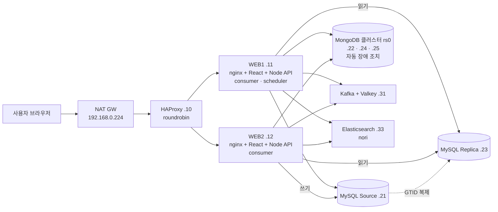
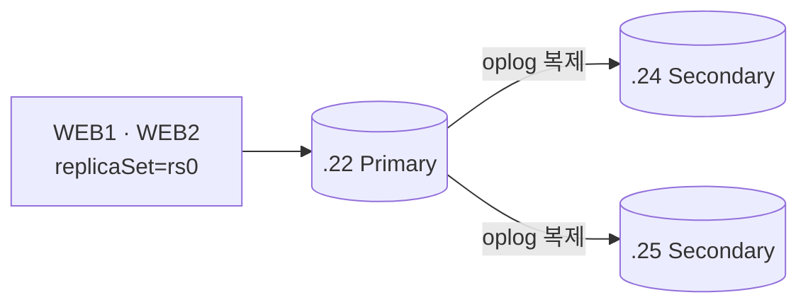

# PLAYLOG 인프라 구성 — HAProxy · WEB1/WEB2 · Redis(Valkey) · Kafka · Elasticsearch · MySQL · MongoDB 클러스터

> 담당: 김남국 · 대상 OS: Rocky Linux 10 · 네트워크: VirtualBox 호스트 전용 `192.168.56.0/24`
> 비밀번호는 이 문서에 적지 않고 `<…>`로 표시함. 실제 값은 각 서버의 설정 파일과 `/opt/playlog/backend/.env`에만 둔다.
> 설정 파일 원본은 [`infra/`](../infra/README.md) 폴더에 서버별로 있다.

## 목차
0. [처음부터 끝까지 설치 순서 (체크리스트)](#0-처음부터-끝까지-설치-순서-체크리스트)
1. [전체 구성](#1-전체-구성)
2. [공통 설정](#2-공통-설정-모든-vm)
3. [HAProxy (.10)](#3-haproxy-1921685610)
4. [WEB1 · WEB2 (.11 · .12)](#4-web1--web2-1921685611--12)
5. [Redis — Valkey (.31)](#5-redis--valkey-1921685631)
6. [Kafka (.31)](#6-kafka-1921685631)
7. [Elasticsearch (.33)](#7-elasticsearch-1921685633)
8. [MySQL Source · Replica (.21 · .23)](#8-mysql-source--replica-1921685621--23)
9. [DB 클러스터 — MongoDB 복제 세트 3노드 (.22 · .24 · .25)](#9-db-클러스터--mongodb-복제-세트-3노드)
10. [처음 데이터 넣기 · 매일 자동 실행](#10-처음-데이터-넣기--매일-자동-실행)
11. [MySQL Workbench로 접속 · 쿼리 실행](#11-mysql-workbench로-접속--쿼리-실행)
12. [상태 확인 명령 모음](#12-상태-확인-명령-모음)
13. [겪은 문제와 해결](#13-겪은-문제와-해결)

쿼리(SQL · MongoDB · Elasticsearch · Redis · Kafka) 전체는 [`docs/QUERIES.md`](QUERIES.md).

---

## 0. 처음부터 끝까지 설치 순서 (체크리스트)

위에서부터 차례로. 각 단계는 아래 절에 명령이 있다.

| # | 서버 | 할 일 | 확인 | 절 |
|---|---|---|---|---|
| 1 | 전체 | 고정 IP · 호스트 이름 · 시간대 · 방화벽 | `ip a` · `timedatectl` | 2 |
| 2 | .21 | MySQL 설치 · `source.cnf` · 재시작 | `SELECT @@server_id, @@gtid_mode` → 1, ON | 8 |
| 3 | .21 | 앱 계정 `playlog` · 복제 계정 `repl` · DB `steam` | `SHOW GRANTS FOR playlog@'192.168.56.%'` | 8 |
| 4 | .23 | MySQL 설치 · `replica.cnf` · Source 데이터 복사 · `START REPLICA` | `SHOW REPLICA STATUS\G` → IO · SQL = Yes | 8 |
| 5 | .22 · .24 · .25 | MongoDB 복제 세트 rs0 · 인증 · 앱 계정 | `rs.status()` → PRIMARY 1 · SECONDARY 2 | 9 |
| 6 | .31 | Valkey 설치 · 비밀번호 | `valkey-cli -a … ping` → PONG | 5 |
| 7 | .31 | Kafka 설치 · KRaft 포맷 · systemd · 토픽 `steam.reviews`(파티션 2) | `kafka-topics.sh --describe` | 6 |
| 8 | .33 | Elasticsearch · nori 플러그인 | `_cat/plugins` → analysis-nori | 7 |
| 9 | .11 | 코드 받기 · `npm ci` · 빌드 · `.env` · `npm run db:init -w backend` | 테이블 15개 + 뷰 1개 | 4 · 8 |
| 10 | .11 · .12 | nginx · SELinux · pm2 (api · consumer, WEB1은 + scheduler) | `curl localhost/api/health` | 4 |
| 11 | .10 | HAProxy | 통계 :8404에서 web1 · web2 UP | 3 |
| 12 | NAT | 192.168.0.224:80 → .10:80 포워딩 | 브라우저로 접속 | — |
| 13 | .11 | 처음 데이터 수집 (상세 → 순위 → 리뷰 발행 → LAG 0 → 정리 · 색인 · 키워드) | 관리자 페이지 행 수 | 10 |
| 14 | .31 | 캐시 비우기 `FLUSHDB` | 화면 새로고침 | 5 |

---

## 1. 전체 구성



| IP | 호스트 | 역할 | 포트 |
|---|---|---|---|
| 192.168.0.224 | nat-gw | 외부 접속 입구 (NAT) | 80 → .10 |
| 192.168.56.10 | haproxy | 로드밸런서 · 상태 검사 | 80, 8404(통계) |
| 192.168.56.11 | web-app-1 | nginx + React + Node API + **consumer + scheduler** | 80, 3001(내부) |
| 192.168.56.12 | web-app-2 | nginx + React + Node API + **consumer** | 80, 3001(내부) |
| 192.168.56.21 | mysql-1 | MySQL 8.4 Source (쓰기) | 3306 |
| 192.168.56.23 | mysql-2 | MySQL 8.4 Replica (읽기) | 3306 |
| 192.168.56.22 · .24 | mongo-1 · 2 | MongoDB 복제 세트 rs0 (Primary · Secondary) | 27017 |
| 192.168.56.25 | mongo-3 | **MongoDB 세 번째 노드 (Secondary)** — 3노드 클러스터 | 27017 |
| 192.168.56.31 | mw | Kafka 4.3 (KRaft) + Valkey | 9092, 6379 |
| 192.168.56.33 | es | Elasticsearch 9.5 + analysis-nori | 9200 |
| 192.168.56.41 | backup | 백업 서버 | — |

**데이터 흐름**
- 화면 요청: 브라우저 → NAT → HAProxy → WEB1/WEB2의 nginx → `/api/*`는 Node(3001) → MySQL · MongoDB · ES · Valkey
- 리뷰 수집: WEB1 scheduler가 Steam API에서 새 리뷰를 받아 Kafka `steam.reviews`에 발행 → WEB1 · WEB2 consumer가 파티션을 하나씩 맡아 MongoDB → MySQL → ES 순서로 저장
- 게임 상세 · 순위는 Kafka를 거치지 않고 WEB1이 MySQL에 바로 저장

---

## 2. 공통 설정 (모든 VM)

```bash
# 고정 IP · 호스트 이름 (예: WEB1)
hostnamectl set-hostname web-app-1
nmcli con mod enp0s8 ipv4.method manual ipv4.addresses 192.168.56.11/24
nmcli con up enp0s8

# 시간대 (DB · 로그 시각을 KST로 맞춤)
timedatectl set-timezone Asia/Seoul

# 방화벽: 서버마다 필요한 포트만 연다 (아래 각 절 참고)
firewall-cmd --permanent --add-port=<포트>/tcp && firewall-cmd --reload
```

SELinux는 켜 둔 채로 운영한다. 필요한 허용은 각 절에 적었다 (nginx · HAProxy).

---

## 3. HAProxy (192.168.56.10)

### 설치
```bash
dnf install -y haproxy
```

### `/etc/haproxy/haproxy.cfg`
```haproxy
global
    log /dev/log local0
    maxconn 2000
    daemon

defaults
    mode    http
    log     global
    option  httplog
    option  forwardfor          # 웹 서버에 실제 사용자 IP 전달 (X-Forwarded-For)
    timeout connect 5s
    timeout client  30s
    timeout server  30s

frontend http_in
    bind *:80
    default_backend playlog_web

backend playlog_web
    balance roundrobin                     # WEB1 → WEB2 → WEB1 … 번갈아
    option  httpchk GET /api/health        # Node API까지 살아 있어야 UP
    http-check expect status 200
    server web1 192.168.56.11:80 check inter 3s fall 3 rise 2
    server web2 192.168.56.12:80 check inter 3s fall 3 rise 2

listen stats
    bind *:8404
    stats enable
    stats uri /
    stats refresh 5s
```

### 실행 · 확인
```bash
haproxy -c -f /etc/haproxy/haproxy.cfg     # 문법 검사 (Configuration file is valid)
setsebool -P haproxy_connect_any 1         # SELinux: 다른 서버로 연결 허용
firewall-cmd --permanent --add-port=80/tcp --add-port=8404/tcp && firewall-cmd --reload
systemctl enable --now haproxy

curl -s http://192.168.56.10/api/health    # 웹 서버까지 연결 확인
```
- 통계 페이지 `http://192.168.56.10:8404` 에서 web1 · web2가 모두 **UP(초록)** 이어야 함
- 한 대가 죽으면 `check`가 3번 실패한 뒤 그 서버를 빼고 살아 있는 서버로만 보냄
- 로그인 세션은 MySQL에 저장하므로 sticky 세션(같은 사용자를 한 서버에 고정)이 필요 없음

---

## 4. WEB1 · WEB2 (192.168.56.11 · .12)

두 서버는 **코드 · 설정이 같고**, scheduler만 WEB1에서 돈다.

### 설치
```bash
dnf install -y nginx git
# Node.js 22 이상 (package.json 스크립트의 --env-file-if-exists 옵션 때문)
dnf module install -y nodejs:22    # 또는 NodeSource 저장소
npm install -g pm2
```

### 코드 받기 · 빌드
```bash
git clone https://github.com/gg-uks/DB_PROJECT.git /opt/playlog
cd /opt/playlog
npm ci                        # 루트에서 한 번 (frontend · backend 워크스페이스 모두 설치)
npm run build -w frontend     # → frontend/dist
```

### `/opt/playlog/backend/.env` (WEB1 · WEB2 동일)
```dotenv
PORT=3001
MYSQL_HOST=192.168.56.21          # 쓰기 (Source)
MYSQL_READ_HOST=192.168.56.23     # 읽기 (Replica)
MYSQL_PORT=3306
MYSQL_USER=playlog
MYSQL_PASSWORD="<MYSQL_PASSWORD>" # #이 들어가면 따옴표로 감쌈
MYSQL_DATABASE=steam
# 비밀번호의 # 은 URL 안에서 %23 으로 바꿔 써야 함
MONGODB_URI=mongodb://playlog:<MONGO_PASSWORD_URL인코딩>@192.168.56.22:27017,192.168.56.24:27017,192.168.56.25:27017/?replicaSet=rs0&authSource=playlog
MONGODB_DATABASE=playlog
KAFKA_BROKERS=192.168.56.31:9092
ELASTICSEARCH_URL=http://192.168.56.33:9200
ELASTICSEARCH_INDEX=playlog-reviews-v2
REDIS_URL=redis://:<VALKEY_PASSWORD_URL인코딩>@192.168.56.31:6379
STEAM_WEB_API_KEY=
REVIEW_MAX_PAGES=10
ADMIN_EMAILS=<관리자 이메일>
```
- `NODE_ENV=production`은 넣지 않는다 → 로그인 쿠키가 `secure`가 되어 http에서는 로그인이 안 됨
- `.env`는 깃허브에 올리지 않는다 (`.gitignore`에 포함)

### nginx `/etc/nginx/conf.d/playlog.conf`
```nginx
server {
    listen 80 default_server;
    server_name _;

    root /opt/playlog/frontend/dist;     # React 빌드 결과
    index index.html;

    location /api/ {
        proxy_pass http://127.0.0.1:3001;          # Node API
        proxy_set_header Host $host;
        proxy_set_header X-Forwarded-For $proxy_add_x_forwarded_for;
    }

    location / {
        try_files $uri /index.html;                # React 화면 주소(#/mypage 등)도 index.html로
    }
}
```
```bash
# /etc/nginx/nginx.conf 기본 server 블록의 default_server는 지운다 (두 개면 충돌)
chcon -R -t httpd_sys_content_t /opt/playlog/frontend/dist   # SELinux: nginx가 파일을 읽게
setsebool -P httpd_can_network_connect 1                     # SELinux: nginx → 3001 연결 허용
nginx -t && systemctl enable --now nginx
firewall-cmd --permanent --add-port=80/tcp && firewall-cmd --reload
```

### pm2로 Node 프로세스 실행
| 프로세스 | 하는 일 | WEB1 | WEB2 |
|---|---|:-:|:-:|
| `api` | 화면 API (3001) | ✅ | ✅ |
| `consumer` | Kafka `steam.reviews` 받아서 저장 (파티션 1개씩 담당) | ✅ | ✅ |
| `scheduler` | 매일 수집 · 가공 (중복 수집을 막으려고 **WEB1에만**) | ✅ | — |

```bash
cd /opt/playlog
pm2 start npm --name api      -- run start -w backend
pm2 start npm --name consumer -- run reviews:consume -w backend
pm2 start npm --name scheduler -- run scheduler -w backend     # WEB1만
pm2 save                    # 지금 목록 저장
pm2 startup systemd         # 재부팅 후 자동 시작 (출력되는 명령이 있으면 한 번 더 실행)
```
- `.env`를 바꾼 뒤에는 `pm2 restart api consumer --update-env`
- 코드를 바꾼 뒤에는 `git pull && npm ci && npm run build -w frontend && pm2 restart all`

---

## 5. Redis — Valkey (192.168.56.31)

Rocky 10은 Redis 대신 호환되는 **Valkey**를 제공한다. 앱은 `redis` 패키지로 그대로 접속한다. 화면 결과 캐시(30초 ~ 1시간)만 저장하므로 지워져도 데이터 손실은 없다.

```bash
dnf install -y valkey
```
`/etc/valkey/valkey.conf`에서 아래 항목을 바꾸거나 추가:
```conf
bind 0.0.0.0
protected-mode yes
requirepass <VALKEY_PASSWORD>
maxmemory 256mb
maxmemory-policy allkeys-lru     # 꽉 차면 오래 안 쓴 키부터 지움 (캐시 용도)
```
```bash
firewall-cmd --permanent --add-port=6379/tcp && firewall-cmd --reload
systemctl enable --now valkey
systemctl restart valkey          # 이미 켜져 있었다면 설정 반영을 위해 재시작

valkey-cli -a '<VALKEY_PASSWORD>' --no-auth-warning ping    # PONG
valkey-cli ping                                              # NOAUTH → 비밀번호 설정 OK
valkey-cli -a '<VALKEY_PASSWORD>' --no-auth-warning FLUSHDB  # 캐시 비우기 (데이터 다시 만든 뒤)
```

---

## 6. Kafka (192.168.56.31)

리뷰 수집만 Kafka를 거친다. 토픽 `steam.reviews`의 **파티션 2개**를 WEB1 · WEB2의 consumer(같은 그룹 `playlog-reviews-db-v3`)가 하나씩 맡는다.

### 설치 (KRaft 모드 · ZooKeeper 없음)
```bash
dnf install -y java-21-openjdk-headless
tar -xzf kafka_2.13-4.3.2.tgz -C /opt && ln -s /opt/kafka_2.13-4.3.2 /opt/kafka
```
`/opt/kafka/config/server.properties` 중 바꾸는 부분:
```properties
process.roles=broker,controller
node.id=1
controller.quorum.voters=1@localhost:9093
listeners=PLAINTEXT://0.0.0.0:9092,CONTROLLER://localhost:9093
advertised.listeners=PLAINTEXT://192.168.56.31:9092    # 웹 서버가 접속할 주소
controller.listener.names=CONTROLLER
log.dirs=/var/lib/kafka
num.partitions=2
auto.create.topics.enable=false                         # 앱도 자동 생성 안 함
```
```bash
mkdir -p /var/lib/kafka
KAFKA_CLUSTER_ID=$(/opt/kafka/bin/kafka-storage.sh random-uuid)
/opt/kafka/bin/kafka-storage.sh format -t $KAFKA_CLUSTER_ID -c /opt/kafka/config/server.properties
```

### systemd `/etc/systemd/system/kafka.service`
```ini
[Unit]
Description=Apache Kafka (KRaft)
After=network.target

[Service]
Type=simple
ExecStart=/opt/kafka/bin/kafka-server-start.sh /opt/kafka/config/server.properties
ExecStop=/opt/kafka/bin/kafka-server-stop.sh
Restart=on-failure

[Install]
WantedBy=multi-user.target
```
```bash
systemctl daemon-reload && systemctl enable --now kafka
firewall-cmd --permanent --add-port=9092/tcp && firewall-cmd --reload
```

### 토픽 만들기 · 확인
```bash
cd /opt/kafka/bin
./kafka-topics.sh --bootstrap-server localhost:9092 --create --topic steam.reviews --partitions 2 --replication-factor 1
./kafka-topics.sh --bootstrap-server localhost:9092 --describe --topic steam.reviews

# consumer가 다 처리했는지 (두 파티션 LAG = 0 이면 끝, HOST가 .11 · .12로 나뉘면 분산 OK)
./kafka-consumer-groups.sh --bootstrap-server localhost:9092 --describe --group playlog-reviews-db-v3
```
- consumer는 MongoDB · MySQL · ES 저장이 **모두 성공한 뒤에만** 오프셋을 커밋한다 → 중간에 죽으면 같은 리뷰를 다시 받지만, PK + UPSERT라 중복 저장되지 않는다
- 실측 (2026-11-10): 발행 7,495건 → 파티션 0 = 3,740건(WEB1) · 파티션 1 = 3,755건(WEB2) · LAG 0

---

## 7. Elasticsearch (192.168.56.33)

리뷰 본문 형태소 분석(nori) · 워드클라우드 집계 · 자연어 검색에 쓴다.

### 설치
```bash
rpm --import https://artifacts.elastic.co/GPG-KEY-elasticsearch
cat > /etc/yum.repos.d/elasticsearch.repo <<'EOF'
[elasticsearch]
name=Elasticsearch 9.x
baseurl=https://artifacts.elastic.co/packages/9.x/yum
gpgcheck=1
gpgkey=https://artifacts.elastic.co/GPG-KEY-elasticsearch
enabled=1
EOF
dnf install -y elasticsearch
/usr/share/elasticsearch/bin/elasticsearch-plugin install analysis-nori    # 한국어 형태소 분석기
```

### `/etc/elasticsearch/elasticsearch.yml`
```yaml
cluster.name: playlog
node.name: es-1
network.host: 0.0.0.0
http.port: 9200
discovery.type: single-node
xpack.security.enabled: false      # 내부망 전용 · 실습 환경이라 인증 끔
```
메모리는 `/etc/elasticsearch/jvm.options.d/heap.options`에 `-Xms1g` / `-Xmx1g` (VM 메모리의 절반 이하).

```bash
firewall-cmd --permanent --add-port=9200/tcp && firewall-cmd --reload
systemctl enable --now elasticsearch

curl -s localhost:9200                                  # 버전 정보
curl -s localhost:9200/_cat/plugins                     # analysis-nori 보이면 OK
curl -s -H 'Content-Type: application/json' localhost:9200/_analyze \
  -d '{"tokenizer":"nori_tokenizer","text":"친구들이랑 하면 시간 순삭"}'   # 형태소 분석 확인
curl -s localhost:9200/playlog-reviews-v2/_count        # 색인된 리뷰 수 (MySQL REVIEW와 같아야 함)
```
- 인덱스 `playlog-reviews-v2`는 앱이 만든다 (`npm run reviews:index -w backend -- --recreate`). 명사(NNG · NNP) · 영어(SL)만 남기는 `ko_nouns` 분석기를 쓴다.
- `--recreate`는 consumer가 쉬고 있을 때(LAG 0) 실행한다. 리뷰를 넣는 중에 실행하면 인덱스를 지운 사이 consumer가 먼저 만들어 `already exists` 오류가 난다.

---

## 8. MySQL Source · Replica (192.168.56.21 · .23)

쓰기는 Source(.21), 화면 조회는 Replica(.23). 앱이 연결을 2개(`writePool` · `readPool`) 두고 나눠 보낸다. 로그인 · 세션 확인처럼 방금 쓴 값을 바로 읽어야 하는 쿼리는 Source에서 읽는다 (복제 지연 대비).

### ① 설치 (두 서버 모두)
```bash
dnf install -y mysql-server            # Rocky 10: MySQL 8.4 · 서비스 이름은 mysqld
systemctl enable --now mysqld
mysql_secure_installation              # root 비밀번호 · 익명 계정 삭제
firewall-cmd --permanent --add-port=3306/tcp && firewall-cmd --reload
```

### ② 설정 — `/etc/my.cnf.d/mysql-server.cnf`의 `[mysqld]`
- Source(.21): [`infra/mysql/source.cnf`](../infra/mysql/source.cnf) — `server-id=1` · `log-bin` · `gtid_mode=ON`
- Replica(.23): [`infra/mysql/replica.cnf`](../infra/mysql/replica.cnf) — `server-id=2` · `relay-log` · `super_read_only=ON`
- 두 서버 모두 `default-time-zone='+09:00'` · `utf8mb4`
```bash
systemctl restart mysqld
mysql -u root -p -e "SELECT @@server_id, @@gtid_mode, @@time_zone, @@character_set_server"
```

### ③ Source(.21): 계정 · DB · 테이블
```sql
CREATE DATABASE steam CHARACTER SET utf8mb4 COLLATE utf8mb4_0900_ai_ci;
CREATE USER 'playlog'@'192.168.56.%' IDENTIFIED BY '<MYSQL_PASSWORD>';
GRANT ALL PRIVILEGES ON steam.* TO 'playlog'@'192.168.56.%';
CREATE USER 'repl'@'192.168.56.%' IDENTIFIED BY '<REPL_PASSWORD>';
GRANT REPLICATION SLAVE ON *.* TO 'repl'@'192.168.56.%';
```
테이블은 WEB1에서 앱 스크립트로 만든다 (`backend/db/schema.sql` 실행 · 여러 번 실행해도 안전):
```bash
cd /opt/playlog && npm run db:init -w backend     # 테이블 15개 + 뷰 V_GAME_SUMMARY
```
- 테이블 이름은 대문자(GAME · REVIEW). 리눅스 MySQL은 대소문자를 구분하므로 Windows에서 만든 덤프(소문자)를 가져오지 말고 VM에서 새로 만든다.

### ④ Replica(.23): Source 데이터 복사 → 복제 시작
```bash
# .21에서
mysqldump -u root -p --all-databases --single-transaction --triggers --routines --events > all.sql
scp all.sql root@192.168.56.23:/root/
```
```sql
-- .23에서 (super_read_only가 켜져 있으면 root도 못 씀 → 잠깐 끔)
SET GLOBAL super_read_only = OFF;
RESET BINARY LOGS AND GTIDS;
SOURCE /root/all.sql;
CHANGE REPLICATION SOURCE TO
  SOURCE_HOST='192.168.56.21', SOURCE_USER='repl', SOURCE_PASSWORD='<REPL_PASSWORD>',
  SOURCE_AUTO_POSITION=1, GET_SOURCE_PUBLIC_KEY=1;
START REPLICA;
SET GLOBAL super_read_only = ON;
SHOW REPLICA STATUS\G      -- Replica_IO_Running: Yes · Replica_SQL_Running: Yes · Seconds_Behind_Source: 0
```
- 덤프에 `playlog` 계정이 이미 들어 있어 Replica에서 `CREATE USER`를 다시 하면 `ERROR 1396` → 하지 않는다.

### ⑤ 복제 확인
```sql
-- .21
CREATE TABLE steam.repl_test (id INT PRIMARY KEY); INSERT INTO steam.repl_test VALUES (1);
-- .23  → 1이 보이면 OK
SELECT * FROM steam.repl_test;
INSERT INTO steam.repl_test VALUES (2);     -- ERROR 1290 (super_read_only) → 정상
-- .21
DROP TABLE steam.repl_test;                 -- .23에서도 사라짐
```

---

## 9. DB 클러스터 — MongoDB 복제 세트 3노드

### 왜 3대인가
| 구성 | Primary 서버가 죽으면 |
|---|---|
| 2대 (.22 · .24) — 이전 | 남은 1대는 과반(2표 중 2표)을 못 얻어 **Primary를 뽑지 못함 → 쓰기 중단** |
| **3대 (.22 · .24 · .25) — 현재** | 남은 2대가 과반(3표 중 2표)으로 **새 Primary를 자동 선출** (보통 10초 안) |

- .25는 데이터를 모두 복제하는 **Secondary**(PSS 구성). 투표만 하는 arbiter보다, 한 대가 죽어도 데이터 사본이 2개 남고 `w: majority` 쓰기가 계속된다.
- MySQL은 Source(.21) → Replica(.23) 비동기 복제를 그대로 쓴다. 클러스터로 묶는 것은 MongoDB만.



### ① .25 준비 — 기존 노드와 **같은 MongoDB 버전** 설치
```bash
hostnamectl set-hostname mongo-3
nmcli con mod enp0s8 ipv4.method manual ipv4.addresses 192.168.56.25/24 && nmcli con up enp0s8
timedatectl set-timezone Asia/Seoul

# .22에서 버전 · 저장소 확인 후 같은 버전으로
#   (.22)  mongod --version ; cat /etc/yum.repos.d/mongodb-org-*.repo
scp root@192.168.56.22:/etc/yum.repos.d/mongodb-org-*.repo /etc/yum.repos.d/
dnf install -y mongodb-org
```

### ② 인증 키 파일 복사 — 복제 세트 멤버끼리 같은 keyFile이어야 서로 인증됨
```bash
# .22의 설정에서 keyFile 경로 확인:  grep -A3 '^security' /etc/mongod.conf
scp root@192.168.56.22:<keyFile 경로> <keyFile 경로>
chown mongod:mongod <keyFile 경로> && chmod 400 <keyFile 경로>
```

### ③ `/etc/mongod.conf` — .22와 같은 값 + bindIp만 이 서버
```yaml
net:
  port: 27017
  bindIp: 127.0.0.1,192.168.56.25
replication:
  replSetName: rs0
security:
  authorization: enabled
  keyFile: <keyFile 경로>
```
```bash
firewall-cmd --permanent --add-port=27017/tcp && firewall-cmd --reload
systemctl enable --now mongod
```
.22 · .24의 방화벽도 .25에서 27017로 들어오는 연결을 허용해야 한다.

### ④ Primary에서 멤버 추가
```bash
mongosh "mongodb://admin:<ADMIN_PASSWORD>@192.168.56.22:27017,192.168.56.24:27017/?replicaSet=rs0&authSource=admin"
```
```js
rs.add("192.168.56.25:27017")
rs.status().members.map(m => [m.name, m.stateStr, m.health])
// [ [ '192.168.56.22:27017', 'PRIMARY', 1 ],
//   [ '192.168.56.24:27017', 'SECONDARY', 1 ],
//   [ '192.168.56.25:27017', 'SECONDARY', 1 ] ]   ← STARTUP2(초기 복사) → SECONDARY
rs.conf().members.length    // 3
```
- 처음에는 `STARTUP2`(데이터 전체 복사) 상태였다가 끝나면 `SECONDARY`가 된다.
- 앱 계정 `playlog`과 데이터는 복제로 그대로 넘어오므로 .25에서 따로 만들 것이 없다.

### ⑤ 앱 접속 주소에 .25 추가 (WEB1 · WEB2)
```dotenv
MONGODB_URI=mongodb://playlog:<MONGO_PASSWORD_URL인코딩>@192.168.56.22:27017,192.168.56.24:27017,192.168.56.25:27017/?replicaSet=rs0&authSource=playlog
```
```bash
pm2 restart api consumer --update-env
```
드라이버는 목록 중 한 대에만 닿으면 나머지 멤버와 현재 Primary를 스스로 찾는다. 세 주소를 모두 적어 두면 어느 한 대가 꺼져 있어도 처음 연결이 된다.

### ⑥ 장애 조치 시험 (시연용)
```bash
# 1) 지금 Primary 확인
mongosh "<위 admin 접속 주소>" --quiet --eval 'rs.hello().primary'
# 2) Primary 서버(.22)에서 mongod 중지
systemctl stop mongod
# 3) 10초쯤 뒤 다시 확인 → .24 또는 .25가 새 Primary
mongosh "mongodb://admin:<ADMIN_PASSWORD>@192.168.56.24:27017,192.168.56.25:27017/?replicaSet=rs0&authSource=admin" --quiet --eval 'rs.hello().primary'
# 4) 사이트에서 리뷰 목록(본문 = MongoDB)이 계속 보이는지 확인
# 5) .22 다시 시작 → Secondary로 자동 합류
systemctl start mongod
```

---

## 10. 처음 데이터 넣기 · 매일 자동 실행

WEB1에서 순서대로 (각 명령이 끝난 뒤 다음):
```bash
cd /opt/playlog
npm run collect:details -w backend    # 게임 상세 → MySQL (30개)
npm run collect:ranks   -w backend    # 주간 순위
npm run reviews:produce -w backend    # 새 리뷰 → Kafka
#   ↳ Kafka에서 LAG 0 확인 (6절) 후
npm run reviews:trim    -w backend    # 게임 × 추천/비추천마다 최신 125건만
npm run reviews:index   -w backend -- --recreate   # ES 재색인
npm run keywords:extract -w backend -- --rebuild   # nori 키워드 추출
npm run keywords:aggregate -w backend              # GAME_KEYWORD 집계
```

scheduler(WEB1)가 매일 자동 실행:
| 시각 | 작업 |
|---|---|
| 03:00 | 게임 상세 수집 · 새 리뷰 Kafka 발행 |
| 04:30 | 표본 정리 → ES 색인 → 키워드 추출 → 집계 |
| 05:00 | 주간 순위 |

---

## 11. MySQL Workbench로 접속 · 쿼리 실행

1. **접속 만들기**: `+` → Connection Name `PLAYLOG-Source` · Hostname `192.168.56.21` · Port `3306` · Username `playlog` · Default Schema `steam`
   - 읽기 서버도 같은 방법으로 `PLAYLOG-Replica` (`192.168.56.23`) — 조회만 가능 (super_read_only)
2. MySQL 쪽 준비 (Source에서 한 번, Replica로 자동 복제):
   ```sql
   CREATE USER 'playlog'@'192.168.56.%' IDENTIFIED BY '<MYSQL_PASSWORD>';
   GRANT ALL PRIVILEGES ON steam.* TO 'playlog'@'192.168.56.%';
   ```
   방화벽: `firewall-cmd --permanent --add-port=3306/tcp && firewall-cmd --reload`
3. **쿼리 실행**: `backend/db/ALL_QUERIES.sql`을 열어 ⚡ 실행
   - 데이터를 바꾸는 INSERT · UPDATE · DELETE는 `/* */` 주석 안에 있어 실행되지 않음
   - 맨 위에서 `@appid` · `@genre` 같은 예시 값을 자동으로 정하고 아래 SELECT에서 씀
4. **ERD 보기**: Database → Reverse Engineer → `steam` 선택 → 실제 테이블로 ERD 생성

---

## 12. 상태 확인 명령 모음

```bash
# HAProxy (.10)
systemctl status haproxy ; curl -s localhost/api/health
# WEB (.11 · .12)
pm2 list ; pm2 logs consumer --lines 20 --nostream ; curl -s localhost:3001/api/health
# Valkey (.31)
valkey-cli -a '<VALKEY_PASSWORD>' --no-auth-warning info keyspace
# Kafka (.31)
/opt/kafka/bin/kafka-consumer-groups.sh --bootstrap-server localhost:9092 --describe --group playlog-reviews-db-v3
# MongoDB 클러스터 (.22 · .24 · .25 중 아무 곳)
mongosh "<admin 접속 주소>" --quiet --eval 'rs.status().members.map(m => [m.name, m.stateStr])'
# ES (.33)
curl -s localhost:9200/_cluster/health?pretty ; curl -s localhost:9200/playlog-reviews-v2/_count
# 웹 → ES가 실제로 쓰이는지 (source 가 elasticsearch 이면 OK)
curl -s 'http://192.168.56.10/api/analytics/games/413150/wordcloud?side=pos' | head -c 120
```

---

## 13. 겪은 문제와 해결

| 증상 | 원인 | 해결 |
|---|---|---|
| `Invalid URL` · Redis/Mongo 접속 실패 | 비밀번호의 `#`이 URL에서 주소 끝으로 해석됨 | URL 안에서는 `#` → `%23` |
| 502 Bad Gateway | Node API가 아직 시작 중이거나 꺼짐 | `pm2 list` · `pm2 logs api` 확인 |
| 예전 화면이 뜸 · 포트 3000 | 예전 프로젝트(pm2 `steam-api`, nginx `steam.conf`)가 남아 있음 | `pm2 delete steam-api` · `steam.conf` → `.bak` |
| nginx가 다른 사이트를 보여줌 | `default_server`가 두 곳에 있음 | `nginx.conf` 기본 server 블록에서 제거 |
| 정적 파일 403 · API 502 (SELinux) | nginx의 파일 읽기 · 네트워크 연결이 막힘 | `chcon … httpd_sys_content_t` · `setsebool -P httpd_can_network_connect 1` |
| Valkey 비밀번호가 안 먹음 | 이미 켜진 상태에서 설정만 바꿈 | `systemctl restart valkey` |
| consumer가 초당 1건만 처리 | 리뷰 1건마다 ES `refresh=wait_for`(최대 1초)를 기다림 | consumer 색인은 `refresh=false` → 남은 6,881건을 약 4분에 처리 (`fix/consumer-es-refresh` 패치 — main에 머지 전이면 VM에서 `review-search.js`의 `_bulk?refresh=wait_for`를 `refresh=false`로) |
| ES 재색인 `already exists` | consumer가 리뷰를 넣는 중에 `--recreate` 실행 | Kafka LAG 0 확인 후 실행 |
| 워드클라우드가 옛 결과 | Valkey에 1시간 캐시가 남음 | `FLUSHDB` 후 새로고침 |
| scheduler가 2개 | 명령을 두 번 붙여넣음 → 매일 수집이 두 번 | `pm2 delete <id>` · `pm2 save` |
| `ERROR 1290 super_read_only` (Replica) | Replica는 쓰기 금지 상태 | 초기 복사 때만 `SET GLOBAL super_read_only=OFF` → 끝나면 ON |
| `ERROR 1396` CREATE USER 실패 (Replica) | 덤프로 계정이 이미 복제됨 | Replica에서는 계정을 만들지 않음 |
| `Unit mysql.service not found` | Rocky의 서비스 이름은 `mysqld` | `systemctl restart mysqld` |
| mysqldump 결과가 0바이트 | 비밀번호가 틀려 덤프 실패 (오류는 화면에만) | `ls -l all.sql`로 크기 확인 후 다시 |
| 셸에서 SQL을 입력해 오류 | bash 프롬프트에 SQL을 바로 씀 | `mysql -u … -p` 접속 후 `mysql>`에서, 또는 `mysql -e "…"` |
| MySQL 8 `ONLY_FULL_GROUP_BY` 오류 | `GROUP BY DATE(req_at)` 처럼 SELECT 식과 다름 | SELECT 별칭으로 `GROUP BY day` |
| MongoDB `requires authentication` | 인증이 켜진 복제 세트에 계정 없이 접속 | 앱 전용 계정(`readWrite@playlog`) + `authSource=playlog` |
